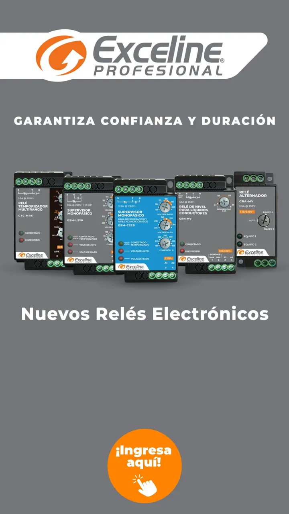
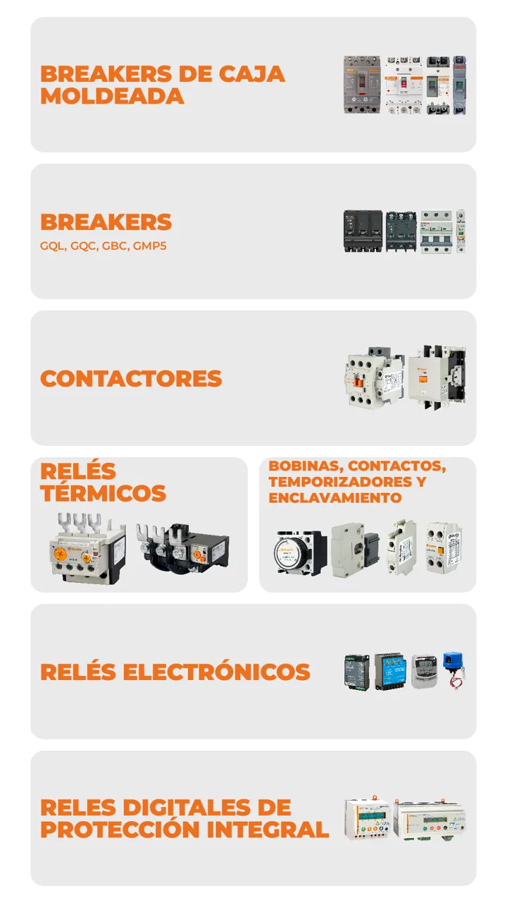
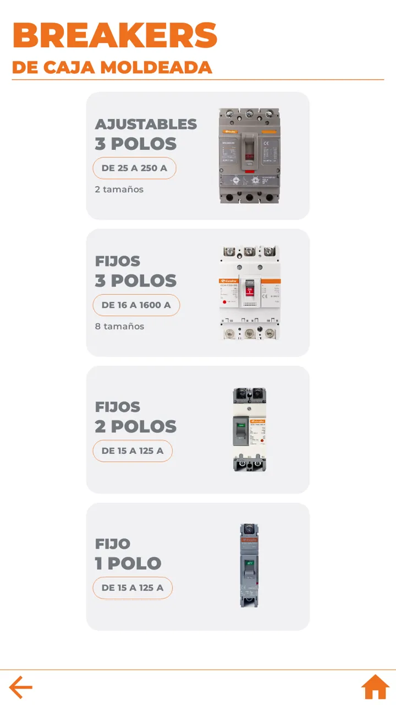
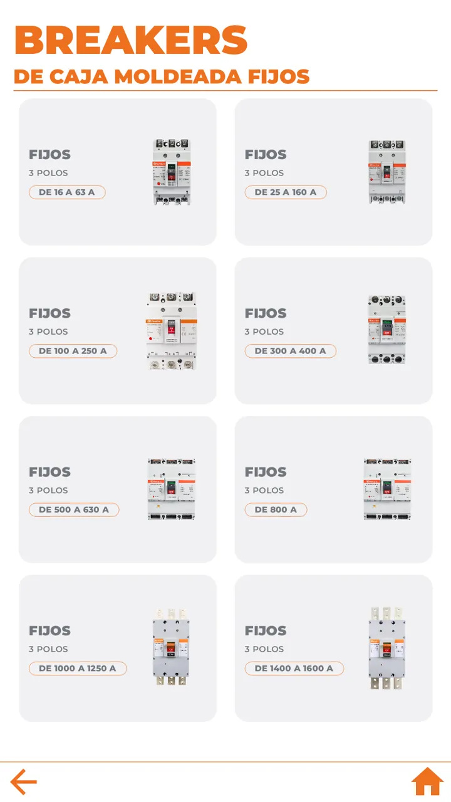
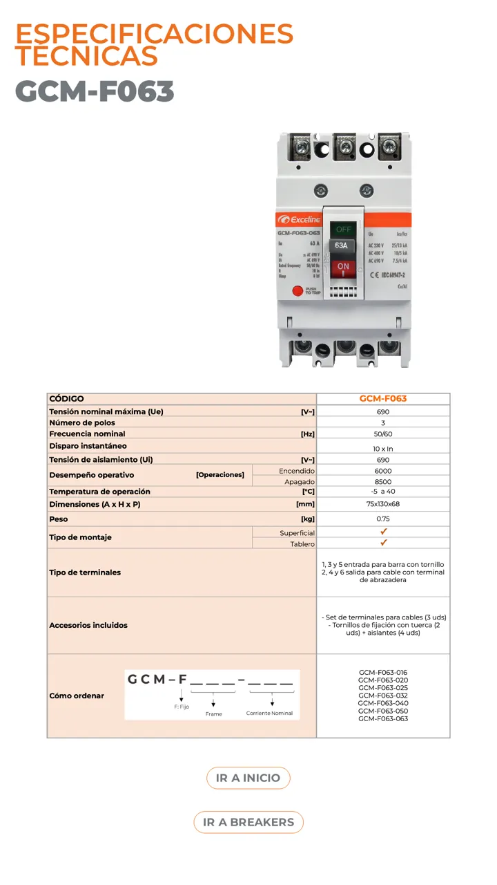

# Gente — Offline kiosk app for touchscreens

Android kiosk app for vertical touchscreen displays: an interactive product catalog for **Exceline Profesional** (breakers, contactors, relays and more), built to run fully offline.

> The source code is private (client project). This repository is a case study.

  
  
  
  
  

## My role

Design and development.

## Highlights

- Touch-first catalog UI built with Jetpack Compose for portrait displays: categories, subcategories, product lists and detail pages with technical specifications
- Works with no network: product data and images are bundled with the app, driven by a single JSON catalog
- Built for 24/7 operation: health monitoring with a heartbeat, periodic memory checks, automatic cleanup and recovery when memory runs low
- Idle timeout returns to the attract screen; video screensaver
- Locked-down kiosk setup guide covering battery, power and launcher settings across device manufacturers

## Stack

Kotlin · Jetpack Compose · Material 3 · Navigation Compose · kotlinx.serialization · Media3 ExoPlayer · Android 11 (API 30)
